# AndersCraft Studio

**Safe, friendly editing for AzerothCore 3.3.5a (Wrath of the Lich King) servers.**

Studio is a Windows desktop app for people who run their own AzerothCore server. It lets you change creatures, items,
quests, loot, SmartAI, conditions, waypoints, spells and the client's DBC tables with plain-English forms instead of raw
SQL and hex editors — and it is built so that **nothing reaches your database until you have reviewed it and said yes**.

| Spell editor | DBC tables | Templates |
|---|---|---|
|  | 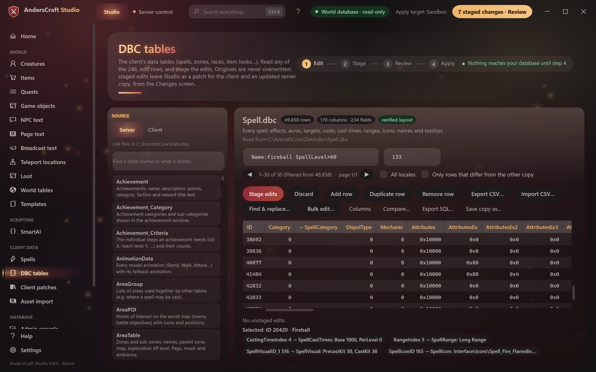 | 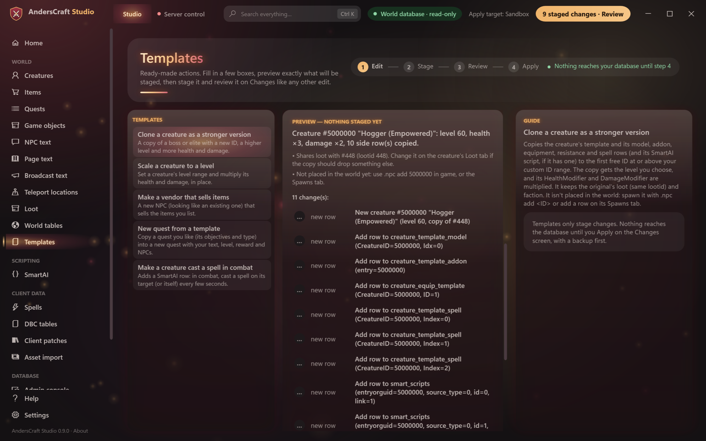 |
| **Conditions** | **Asset import** | **Changes** |
| 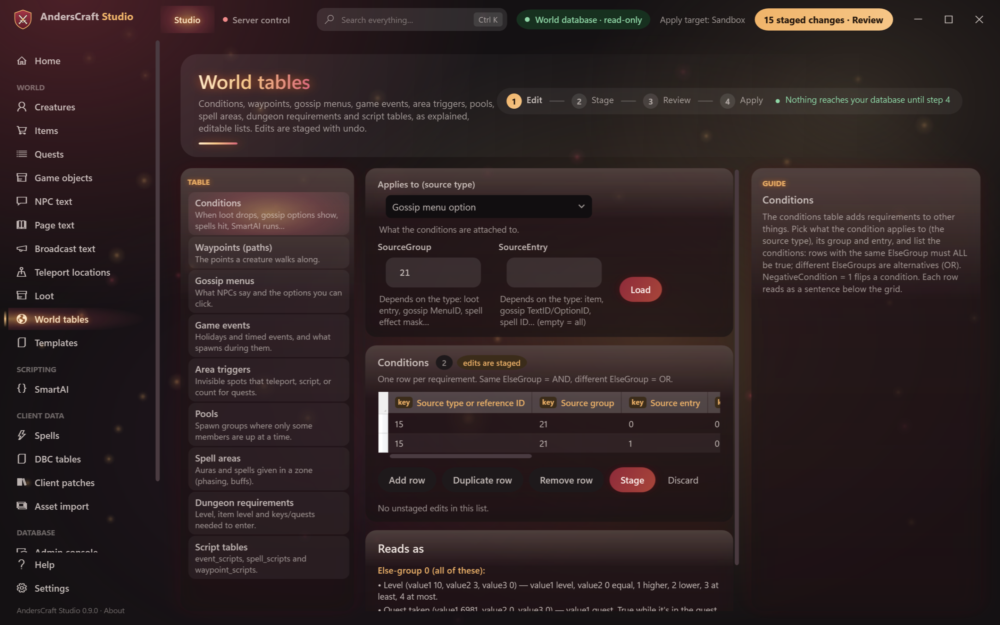 |  | 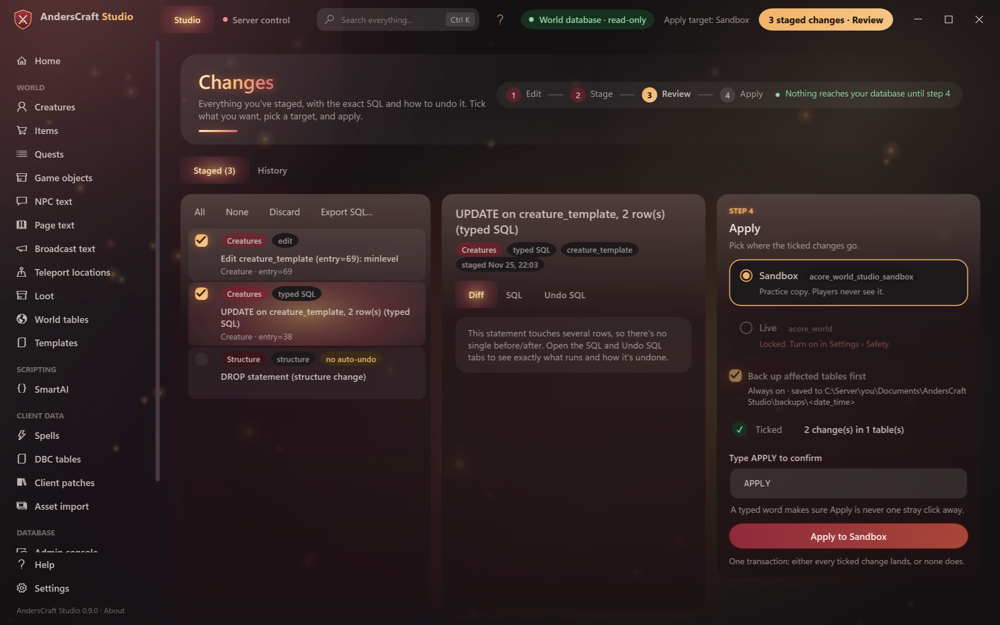 |
| **Game objects** | **NPC text** | **CSV import** |
| 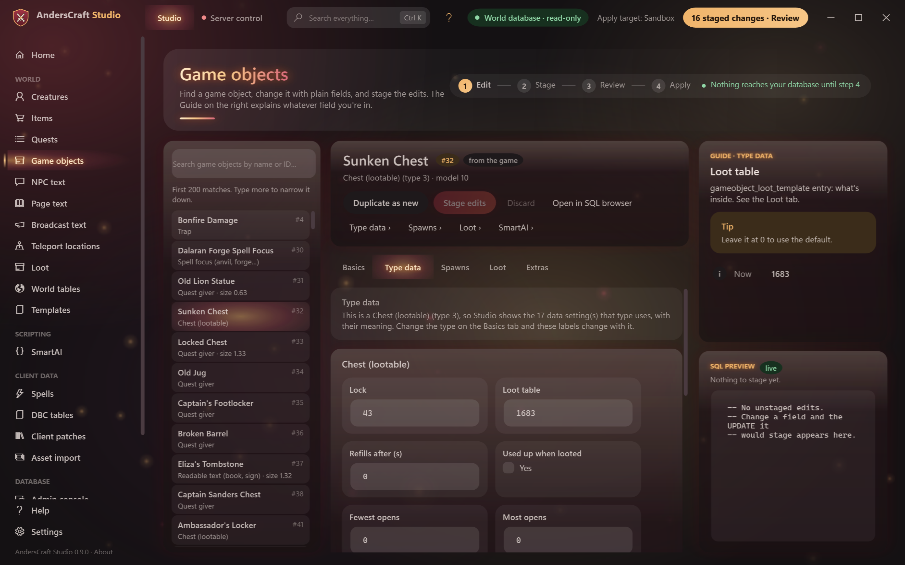 | 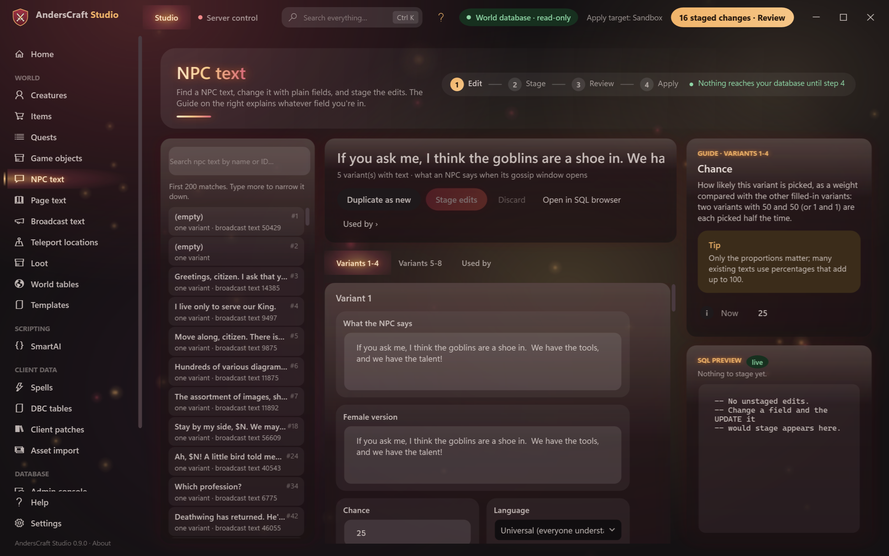 |  |
| **3D model viewer** | Creatures (dressed humanoid NPCs included), game objects and WMO buildings, items, spell effects with their particles, and models you import, textured, with every animation, turn / move / zoom and wireframe. Read straight from your client's archives. |
| **Admin console** | **Look & movement** | **3D viewer** |
| 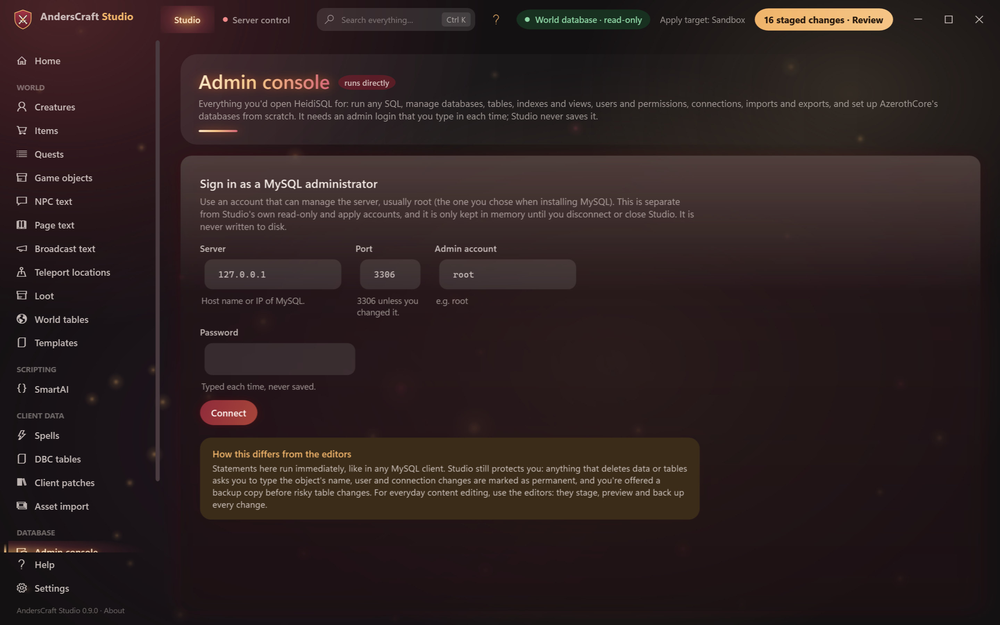 | 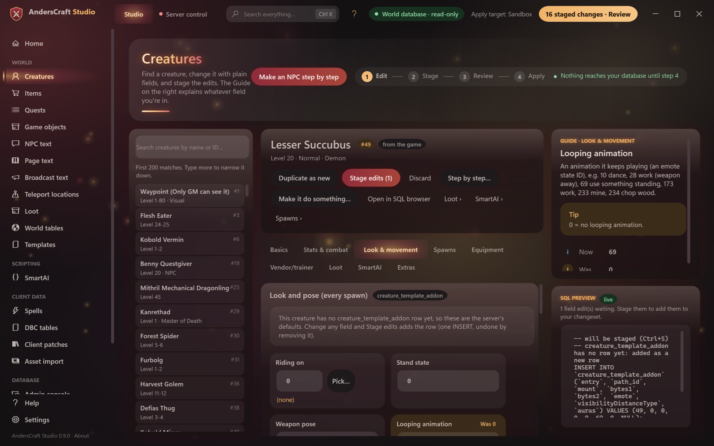 | 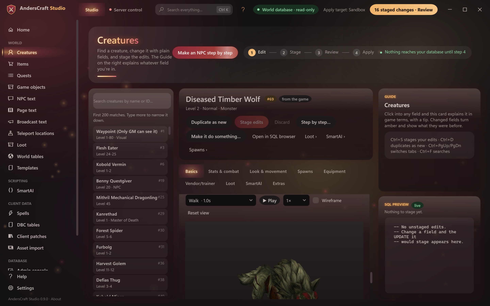 |

## What you can do

| Area | What Studio gives you |
|---|---|
| **Creatures / Items / Quests** | Form editors with an explanation for every field, name pickers instead of IDs, *Duplicate as new*, spawns, equipment, vendor and trainer lists, mount/pose/movement, resistances, kill reputation, formations, quest texts and givers, random enchants. Missing side rows are created on your first edit. |
| **Game objects / NPC text / Page text** | Chests, doors, herbs, signs and portals with their Data0–Data23 settings labelled for the object's type, plus spawns and loot; what NPCs say (8 variants with chances and emotes); books and letters with their pages read in order. |
| **Loot** | Every loot table as readable groups, shared lists (references), and a drop simulator. |
| **SmartAI** | Scripts read as sentences ("When in combat, cast Fireball on its victim every 8–12 s"), with checks, and the creature_text lines of each *Say a line*. |
| **World tables** | Conditions (each row read as a sentence), waypoints/paths, gossip menus, game events, area triggers. |
| **Templates** | Ready-made actions: clone a boss as a stronger version, scale a creature, make a vendor, new quest from a template, make a creature cast a spell. |
| **Spells** | Spell.dbc as a tabbed form with a live in-game tooltip, icon picker, related range/cast-time/duration rows, attributes as tick boxes, the server-side `spell_dbc` row, export/import a spell to a file. |
| **DBC tables** | All 246 client tables with descriptions, verified column layouts, filter, find/replace, bulk edit, CSV and SQL export, compare server ↔ client. |
| **Asset import** | Your own icons (PNG/JPG/BMP/TGA → BLP), creature and item models (.m2 + skins + textures), sounds and any file, placed in a patch and registered in the DBCs. |
| **Client patches** | Build a `patch-X.MPQ`, see which patch wins for each file, install with a backup, uninstall, export a zip for players, browse any MPQ. |
| **Admin console** | Everything HeidiSQL does, behind an admin login you type each time (never saved): run any SQL, databases, tables, indexes, views, users and permissions, connections, server status, import/restore .sql files and folders, export databases, and a guided *Set up AzerothCore* that builds the databases from scratch. Risky statements ask you to type the object's name. |
| **SQL browser** | Every table, structure view, filter, find text, CSV / SQL export, CSV import (staged), query history, multiple result sets, stage a whole `.sql` script. |

## The safety promise

* **Read-only by default.** Studio browses with its own read-only MySQL account in READ ONLY sessions, and checks every
  statement again itself.
* **Stage, review, apply.** Edits go into a *changeset* first, with the old value, the new value and the SQL to undo it.
  The Changes screen shows everything side by side.
* **Backup first, one transaction.** Apply takes a mysqldump backup of the affected tables, asks you to type `APPLY`,
  re-checks every row and runs everything in one transaction — any mismatch rolls it all back. Every apply can be rolled back.
* **Apply again and again.** Applied changes move to History, editors reload what's in the database, and if a row
  changed since you staged an edit, Apply stops and explains it in plain words with choices: refresh the starting point,
  skip the change, or show it.
* **Sandbox first.** Apply goes to a practice copy of your world database until you unlock Live in Settings.
* **Originals are never overwritten.** DBC edits and imported assets leave Studio as files in its own folders; installing
  a patch backs up anything it replaces and refuses while the game is running.

## Requirements

* Windows 10 or 11 (64-bit).
* An **AzerothCore 3.3.5a** server (game client build 12340) you run, its `worldserver.conf` readable from this PC.
* Its database on **MySQL 8.0 / 8.4** (tested) or **MariaDB 10.4+** (supported, not yet tested against a live MariaDB
  server). TrinityCore 3.3.5 uses a similar database but hasn't been tested; some editors may not match its tables.
* `mysqldump.exe` (MySQL) or `mariadb-dump.exe` (MariaDB) for the backup before each Apply. Studio finds it in the usual place.
* For the Admin console: a MySQL administrator login (usually root). It's only needed for admin work and never saved.
* Optional: your 3.3.5a game client folder (icons, client DBCs, patches).
* Download **AndersCraftStudio-0.9.zip** (self-contained, nothing else to install). The small framework-dependent build
  needs the [.NET 10 Desktop Runtime](https://dotnet.microsoft.com/download/dotnet/10.0).

## Getting started

1. Unzip anywhere and run `AndersCraftStudio.exe`. The setup wizard opens.
2. **Find your server**: *Auto-detect* or *Browse…* to `worldserver.conf`. Studio reads which databases the server uses
   (it never stores the server's own MySQL password).
3. **Safe accounts**: press *Run it now as admin…* and type your MySQL root password once (used for that run, never saved),
   or copy the script into any MySQL tool. It creates a read-only account and an apply-only account for Studio.
4. **Game client** (optional): pick your client folder.
5. **Sandbox** (recommended): *Create sandbox…* then *Run it now as admin…* copies your world database into a practice sandbox.

**No server yet?** Install MySQL 8, open **Admin console** (sidebar), sign in as root and use *Set up AzerothCore*: it creates
the three databases and the server's account and loads AzerothCore's base tables. Start authserver and worldserver once
(they apply the update files themselves), then run the setup wizard above.
6. Open **Home**, read *New to this? Start here*, and try a **Template** — then look at **Changes** to see exactly what
   would happen. Press F1 any time for the Getting started guide and glossary.

**How to use this.** Every main screen has a visual guide: a picture of the screen with numbered markers and short steps
(Creatures, Items, Quests, Loot, SmartAI, Spells, DBC tables, Client patches, Asset import, SQL browser, Admin console,
Changes and the setup wizard). Open it with *How to use this* in the top bar or **Shift+F1**; Help lists them all.

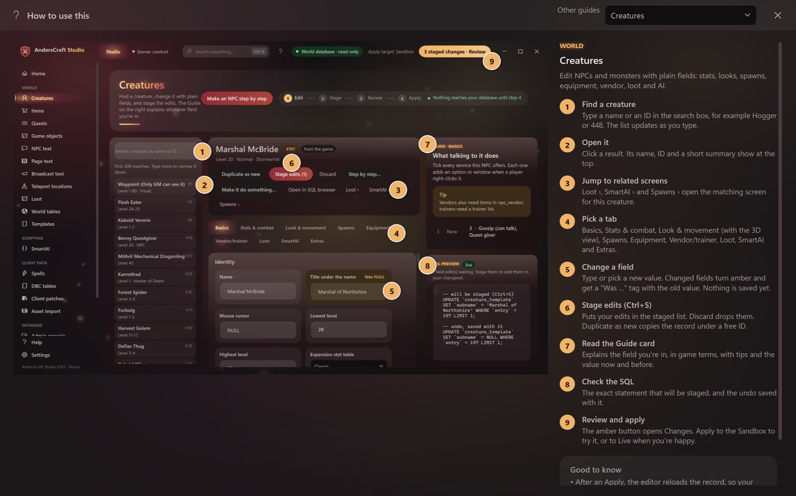

**Step-by-step builders.** For quests, NPCs and creature behaviours there's a guided, linear way in, next to the full
editors: **Make a quest** (the basics, who gives it, what to do: kill / bring items / talk to / use an object / go
somewhere, rewards, texts, who can take it and the chain, then review), **Make an NPC** (what it is, name and look with a 3D
preview, level and strength, what it offers, where it stands via the in-game .gps command) and **Make it do something**
(cast in a fight or at low health, lines when a fight starts or it dies, call for help, greet players, animations, quest
credit). Each can start from nothing, from one of yours, or from one of the game's own (copied as new, or changed in
place), shows a live preview, and stages everything for review: nothing reaches the server before Apply. Find them on Home,
at the top of Creatures and Quests, on every quest and creature (*Step by step…*, *Make it do something…*) and on SmartAI.

**Server control (live).** The second tab at the top. Where Studio's editing is staged and applied after review, Server
control runs your server right now: a live dashboard (login server and each realm: ready or not, uptime, CPU and memory,
players and bots online, the last log line), start / stop / restart with a graceful save first and a backup offered, a crash
watchdog, maintenance mode, players (one or many: kick, mute, ban, teleport, level, mail gold and items), accounts (create,
password, staff rank, expansion, bans), a console with quick commands, live logs with problems in colour, messages, a
shutdown countdown, scheduled messages / restarts / backups, backups you can open or put back, and an audit log of every
action. It replaces the separate AndersCraft Control Panel (import its settings in one click; the old program keeps working).
Settings › *Show technical names* shows column, field and command names next to the plain ones (off by default).

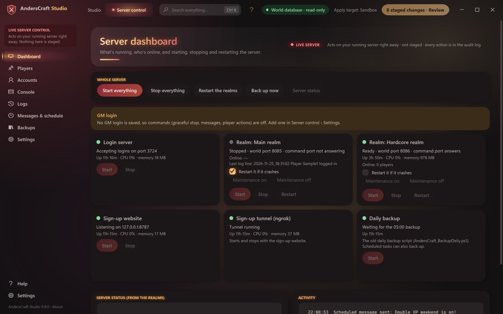

**Making a spell.** Spells › *Create a spell…*: pick damage, heal, buff or passive, fill in the plain fields (amount,
school or what it raises, cast time, cooldown, cost, range, icon, spellbook tab) and watch the tooltip as you type. Studio
builds the whole spell from a real one of the same kind and links it to the spellbook tab you picked. The card *Will it
show in the spellbook?* checks every spell (hidden or passive flags, the spellbook link, the class you test with, and
whether the game client has the same version) with a one-click fix for each problem. *Send to game* puts every spell and
DBC edit into the patch the game really reads last (a new Data\patch-X, or the one that already loads last, updated in
place with a backup), and updates the server's copy. Tick *learns it by themselves* and every character of the class has
the spell after their next login.

**Spell and DBC edits don't use Apply.** On Changes they go out with *Send out DBC edits*: as files for a client patch
(then build and install it on Client patches) and as an updated server copy (then restart worldserver). Once an edit has
gone both ways it moves to History by itself; after just one, press *Done: move to History*.

Your settings and encrypted passwords live in `%APPDATA%\AndersCraftStudio`; changesets, backups, patch work folders and
built patches in `Documents\AndersCraft Studio` (changeable in Settings).

## Known issues

* The **Admin console runs statements directly**, like any MySQL client — that's its job. Content editing belongs in the
  editors, which stage and back up every change. Account, permission and connection changes can't be undone with a click.
* event_scripts and spell_scripts have no primary key: Studio finds each row by all of its values, and Apply refuses if a
  match isn't exactly one row (two identical rows).
* The 3D viewer needs your client folder (setup step 4). Particle effects are approximate (one colour per emitter); buildings
  are drawn without the small props inside them; helmets and shoulders don't animate on their own.
* **Windows SmartScreen** may say *Windows protected your PC* the first time, because the exe isn't code-signed.
  Click **More info** › **Run anyway**. The source is in this repository if you'd rather build it yourself.
* Apply, Roll back, patch Install/Uninstall and the DBC outputs are covered by automated tests against fakes and temporary
  folders; please try them on the sandbox and a copy of your client first.
* 93 of the 246 DBCs have no published column layout and open in raw mode (types guessed from the data, generic names).
* The client load-order view (which MPQ wins) follows the usual 3.3.5a convention; it hasn't been verified inside Wow.exe.
* Spell tooltip preview: player-dependent values (attack power, talents) show "…"; about 60 effects and 80 auras have
  Studio's own summary wording, the rest show the effect/aura name.
* Asset import registers icons, creature models, item models (weapons, shields, helms, shoulders…), body-armour textures
  and sounds; spell visual kits and maps must be wired up by hand (the files can be imported with *Any file*). Helmets need one model per race and gender (`Name_HuM.m2`…), named by you. There is no 3D preview. Imported models must already be 3.3.5a `.m2` (version 264); Studio doesn't convert models.
* MPQ v3/v4 (Cataclysm+) and DB2 files aren't supported — the 3.3.5a client doesn't use them.
* Studio never runs structure changes (CREATE/ALTER/DROP); they can be staged and exported but not applied.

More detail: [README.txt](README.txt) (technical notes), [PARITY_AUDIT.md](PARITY_AUDIT.md), [RELEASE_NOTES.md](RELEASE_NOTES.md).

## Privacy

Studio has **no telemetry**: it sends nothing anywhere. It only talks to the database server you point it at (and checks
that the server's port answers during setup). Your passwords are encrypted for your Windows user; the Admin console's login
is never saved. The log in `%APPDATA%\AndersCraftStudio\logs` stays on your PC, with passwords removed.

## Report a problem

Open an issue at [github.com/damananders/WoWPrivateServerStudio/issues](https://github.com/damananders/WoWPrivateServerStudio/issues).
Help (F1) › *Open logs* shows the log files; attach today's and describe what you did.

## Licence

MIT — see [LICENSE](LICENSE). Not affiliated with or endorsed by Blizzard Entertainment. Studio ships no game data: you
supply your own 3.3.5a client and server.
