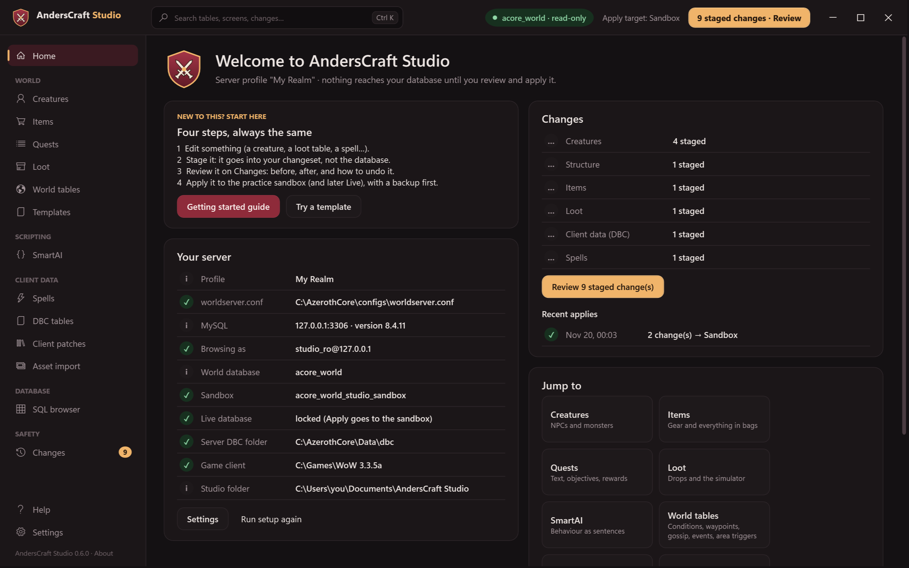
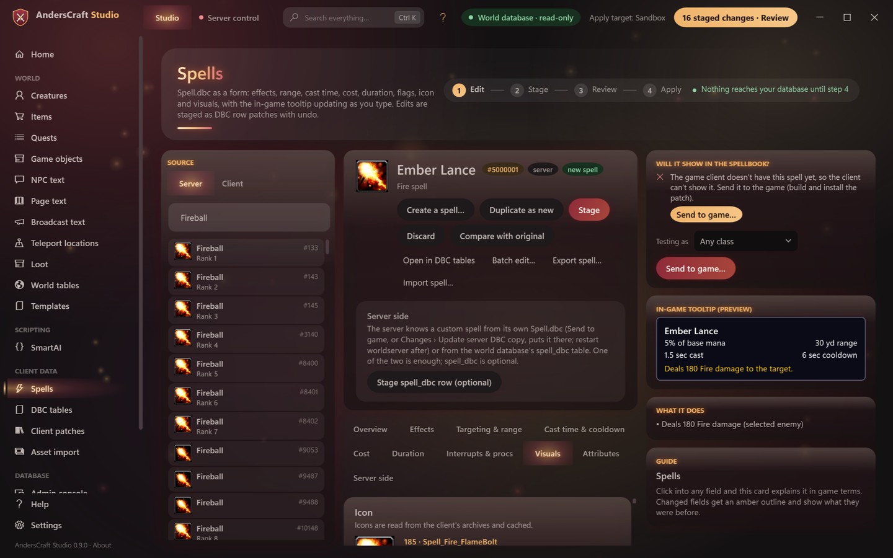
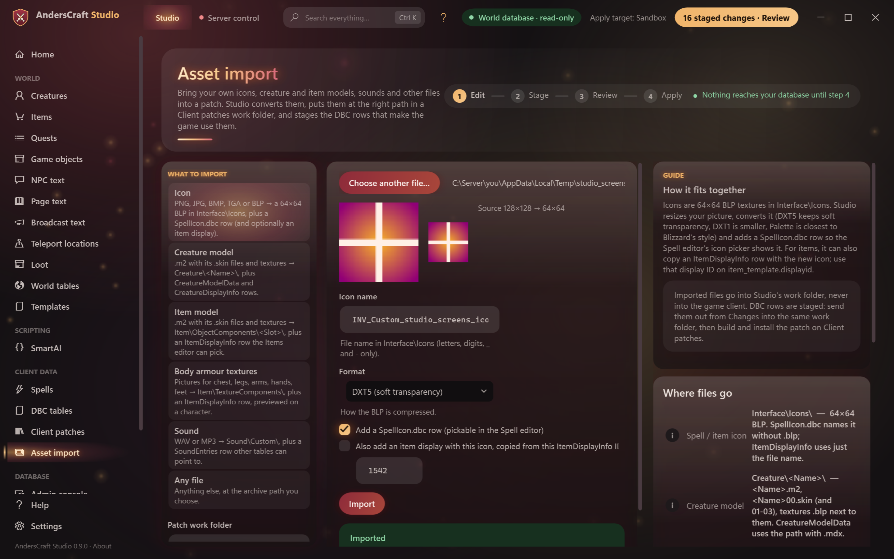
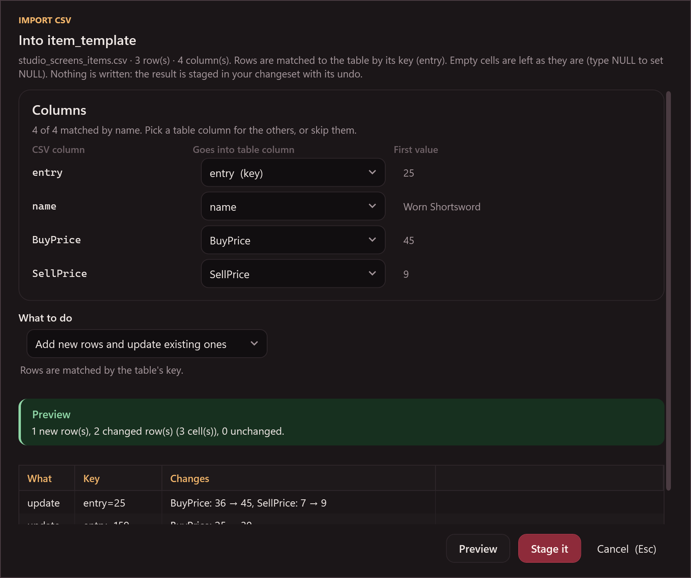

# AndersCraft Studio

**Safe, friendly editing for AzerothCore 3.3.5a (Wrath of the Lich King) servers.**

Studio is a Windows desktop app for people who run their own AzerothCore server. It lets you change creatures, items,
quests, loot, SmartAI, conditions, waypoints, spells and the client's DBC tables with plain-English forms instead of raw
SQL and hex editors — and it is built so that **nothing reaches your database until you have reviewed it and said yes**.

| Spell editor | DBC tables | Templates |
|---|---|---|
|  |  |  |
| **Conditions** | **Asset import** | **Changes** |
|  |  |  |
| **Game objects** | **NPC text** | **CSV import** |
|  |  |  |

## What you can do

| Area | What Studio gives you |
|---|---|
| **Creatures / Items / Quests** | Form editors with an explanation for every field, name pickers instead of IDs, *Duplicate as new*, spawns, equipment, vendor and trainer lists. |
| **Game objects / NPC text / Page text** | Chests, doors, herbs, signs and portals with their Data0–Data23 settings labelled for the object's type, plus spawns and loot; what NPCs say (8 variants with chances and emotes); books and letters with their pages read in order. |
| **Loot** | Every loot table as readable groups, shared lists (references), and a drop simulator. |
| **SmartAI** | Scripts read as sentences ("When in combat, cast Fireball on its victim every 8–12 s"), with checks, and the creature_text lines of each *Say a line*. |
| **World tables** | Conditions (each row read as a sentence), waypoints/paths, gossip menus, game events, area triggers. |
| **Templates** | Ready-made actions: clone a boss as a stronger version, scale a creature, make a vendor, new quest from a template, make a creature cast a spell. |
| **Spells** | Spell.dbc as a tabbed form with a live in-game tooltip, icon picker, related range/cast-time/duration rows, attributes as tick boxes, the server-side `spell_dbc` row, export/import a spell to a file. |
| **DBC tables** | All 246 client tables with descriptions, verified column layouts, filter, find/replace, bulk edit, CSV and SQL export, compare server ↔ client. |
| **Asset import** | Your own icons (PNG/JPG/BMP/TGA → BLP), creature and item models (.m2 + skins + textures), sounds and any file, placed in a patch and registered in the DBCs. |
| **Client patches** | Build a `patch-X.MPQ`, see which patch wins for each file, install with a backup, uninstall, export a zip for players, browse any MPQ. |
| **SQL browser** | Every table, structure view, filter, find text, CSV / SQL export, CSV import (staged), query history, multiple result sets, stage a whole `.sql` script. |

## The safety promise

* **Read-only by default.** Studio browses with its own read-only MySQL account in READ ONLY sessions, and checks every
  statement again itself.
* **Stage, review, apply.** Edits go into a *changeset* first, with the old value, the new value and the SQL to undo it.
  The Changes screen shows everything side by side.
* **Backup first, one transaction.** Apply takes a mysqldump backup of the affected tables, asks you to type `APPLY`,
  re-checks every row and runs everything in one transaction — any mismatch rolls it all back. Every apply can be rolled back.
* **Sandbox first.** Apply goes to a practice copy of your world database until you unlock Live in Settings.
* **Originals are never overwritten.** DBC edits and imported assets leave Studio as files in its own folders; installing
  a patch backs up anything it replaces and refuses while the game is running.

## Requirements

* Windows 10 or 11 (64-bit).
* An AzerothCore **3.3.5a** server you run (its `worldserver.conf` readable from this PC) and its MySQL 8 / MariaDB database.
* MySQL's `mysqldump.exe` (comes with MySQL Server) for the backup before each Apply. Studio finds it in the usual place.
* Optional: your 3.3.5a game client folder (icons, client DBCs, patches).
* Download **AndersCraftStudio-0.7.zip** (self-contained, nothing else to install). The small framework-dependent build
  needs the [.NET 10 Desktop Runtime](https://dotnet.microsoft.com/download/dotnet/10.0).

## Getting started

1. Unzip anywhere and run `AndersCraftStudio.exe`. The setup wizard opens.
2. **Find your server**: *Auto-detect* or *Browse…* to `worldserver.conf`. Studio reads which databases the server uses
   (it never stores the server's own MySQL password).
3. **Safe accounts**: copy the generated script and run it **once yourself** as MySQL root (HeidiSQL, MySQL Workbench or the
   `mysql` command line). It creates a read-only account and an apply-only account for Studio. Press *Test the accounts*.
4. **Game client** (optional): pick your client folder.
5. **Sandbox** (recommended): run the generated script to copy your world database into a practice sandbox.
6. Open **Home**, read *New to this? Start here*, and try a **Template** — then look at **Changes** to see exactly what
   would happen. Press F1 any time for the Getting started guide and glossary.

Your settings and encrypted passwords live in `%APPDATA%\AndersCraftStudio`; changesets, backups, patch work folders and
built patches in `Documents\AndersCraft Studio` (changeable in Settings).

## Known issues

* **Windows SmartScreen** may say *Windows protected your PC* the first time, because the exe isn't code-signed.
  Click **More info** › **Run anyway**. The source is in this repository if you'd rather build it yourself.
* Apply, Roll back, patch Install/Uninstall and the DBC outputs are covered by automated tests against fakes and temporary
  folders; please try them on the sandbox and a copy of your client first.
* 93 of the 246 DBCs have no published column layout and open in raw mode (types guessed from the data, generic names).
* The client load-order view (which MPQ wins) follows the usual 3.3.5a convention; it hasn't been verified inside Wow.exe.
* Spell tooltip preview: player-dependent values (attack power, talents) show "…"; about 60 effects and 80 auras have
  Studio's own summary wording, the rest show the effect/aura name.
* Asset import registers icons, creature models, item models (weapons, shields, helms, shoulders…) and sounds; body armour
  textures, spell visual kits and maps must be wired up by hand (the files can be imported with *Any file*). Helmets need one model per race and gender (`Name_HuM.m2`…), named by you. There is no 3D preview. Imported models must already be 3.3.5a `.m2` (version 264); Studio doesn't convert models.
* MPQ v3/v4 (Cataclysm+) and DB2 files aren't supported — the 3.3.5a client doesn't use them.
* Studio never runs structure changes (CREATE/ALTER/DROP); they can be staged and exported but not applied.

More detail: [README.txt](README.txt) (technical notes), [PARITY_AUDIT.md](PARITY_AUDIT.md), [RELEASE_NOTES.md](RELEASE_NOTES.md).

## Licence

MIT — see [LICENSE](LICENSE). Not affiliated with Blizzard Entertainment. Studio ships no game data.
